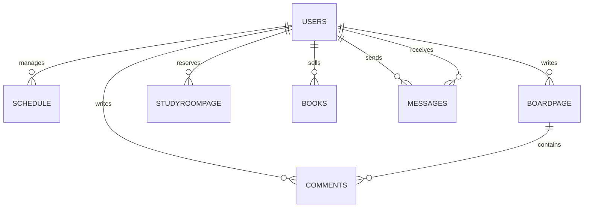

# 🕰️ 에브리휴먼타임 (Every Human Time)

대학생에게 필요한 **시간표, 커뮤니티, 학점 계산, 열람실 예약, 중고책 거래, 스도쿠** 기능을 하나로 모은 통합 웹 서비스입니다.

> 본 저장소는 **5인 팀 프로젝트의 포트폴리오용 저장소**입니다.  
> 저는 프론트엔드에서 **열람실 좌석 예약·배정·취소 기능**을 담당했습니다.  
> 원본 팀 저장소: [hmbyun3212/Human_everytime_project](https://github.com/hmbyun3212/Human_everytime_project)

---

## 📌 프로젝트 정보

| 항목 | 내용 |
| --- | --- |
| 프로젝트명 | 에브리휴먼타임 |
| 프로젝트 형태 | 5인 팀 프로젝트 |
| 진행 시기 | 2026.04 |
| 서비스 대상 | 시간표 관리, 학점 계산, 커뮤니티 및 학내 편의 기능을 한 곳에서 이용하려는 대학생 |
| 담당 역할 | Frontend — 열람실 예약 기능 |

---

## 💡 기획 배경

대학생이 자주 사용하는 시간표, 학점 계산, 커뮤니티, 열람실, 중고책 거래 등의 기능이 여러 서비스에 분산되어 있다는 불편함에서 시작했습니다.

에브리휴먼타임은 대학 생활에 필요한 기능을 하나의 서비스에 통합하여 다음과 같은 가치를 제공하는 것을 목표로 했습니다.

- 시간표와 학점 계산을 통한 학사 관리
- 게시판과 쪽지를 통한 사용자 간 소통
- 열람실 좌석 예약을 통한 편의성 향상
- 중고책 거래를 통한 학생 간 거래 지원
- 스도쿠를 통한 간단한 여가 기능 제공

---

## ✨ 주요 기능

### 🔐 회원 기능

- 회원가입 및 로그인
- 사용자 프로필 조회 및 수정
- 내가 작성한 글과 받은 쪽지 확인

### 📅 시간표

- 요일별 개인 시간표 조회
- 강의명, 교수명, 강의실, 시간 및 색상 설정
- 강의 추가·수정·삭제

### 💬 게시판

- 게시글 작성·조회·수정·삭제
- 댓글 작성
- 사용자 간 커뮤니티 기능

### 🧮 학점 계산기

- 과목명, 학점 및 성적 입력
- 과목 추가·삭제
- 입력한 과목을 기준으로 평균 평점 계산

### 📖 열람실 예약

- 제1·제2 열람실 전환
- 전체 좌석, 빈 좌석 및 이용 중 좌석 현황 조회
- 좌석 배치도를 통한 좌석 선택
- 1시간, 2시간 또는 3시간 단위 이용 시간 선택
- 이용 중인 좌석의 입실 시간, 종료 예정 시간 및 남은 시간 확인
- 퇴실 처리 및 좌석 배정 취소

### 📚 중고책 마켓

- 판매 도서 등록 및 이미지 업로드
- 도서 상태·가격·판매 여부 표시
- 판매자에게 쪽지 보내기
- 판매 완료 처리

### 🧩 스도쿠

- 쉬움·보통·어려움 난이도 선택
- 숫자 입력 및 지우기
- 중복 확인 및 정답 제출

---

## 🙋‍♀️ 담당 기능 — 열람실 예약

프론트엔드에서 **열람실 좌석 예약의 전체 사용자 흐름**을 담당했습니다.

### 구현 내용

- 전체 좌석 수, 빈 좌석 수, 이용 중 좌석 수를 요약 정보로 표시
- 제1 열람실과 제2 열람실을 탭으로 구분
- 좌석 번호가 실제 열람실 배치처럼 보이도록 좌석 배치도 구성
- 빈 좌석을 선택하면 예약 모달을 열고 이용 시간을 선택하도록 구현
- 예약된 좌석을 선택하면 입실 시간, 종료 예정 시간, 남은 시간을 표시
- 퇴실 및 예약 취소 후 좌석 상태와 상단 좌석 현황이 함께 변경되도록 처리
- 빈 좌석과 사용 중 좌석을 서로 다른 상태로 표현해 사용자가 쉽게 구분하도록 구성

### 사용자 흐름

```text
열람실 메뉴 진입
    ↓
제1·제2 열람실 선택
    ↓
빈 좌석 및 이용 중 좌석 현황 확인
    ↓
빈 좌석 선택
    ↓
이용 시간 선택
    ↓
좌석 배정
    ↓
이용 정보 및 남은 시간 확인
    ↓
퇴실 또는 배정 취소
```

### 구현 포인트

- 좌석 상태 변경과 상단 통계 정보가 일치하도록 화면 상태를 함께 갱신했습니다.
- 사용 중인 좌석은 다시 예약할 수 없도록 예약 화면과 이용 정보 화면을 구분했습니다.
- 사용자가 현재 좌석 상태를 빠르게 파악할 수 있도록 좌석 색상과 요약 정보를 활용했습니다.
- 예약부터 취소까지의 작업을 모달 안에서 완료할 수 있도록 사용자 동선을 단순화했습니다.

---

## 🖥️ 주요 화면

> 아래 이미지 경로에 화면 캡처를 추가하면 GitHub README에서 바로 표시됩니다.  
> `docs/images` 폴더를 만든 뒤 이미지 파일을 넣어 주세요.

<!--
### 열람실 전체 좌석 현황


### 좌석 예약


### 이용 좌석 정보 및 취소


-->


---

## 🛠️ 기술 스택

### Frontend

- React
- JavaScript
- HTML5
- CSS3

### Backend

- Java
- Spring Boot
- Gradle

### Database

- MySQL

### 협업 및 형상 관리

- Git
- GitHub

---

## 🗂️ 데이터 구조



열람실 예약 정보에는 사용자, 열람실 번호, 좌석 번호, 입실 시간, 이용 시간, 종료 예정 시간 및 좌석 이용 상태가 저장됩니다.

---

## 👥 역할 분담

| 팀원 | 담당 기능 |
| --- | --- |
| 김도형 | 로그인·회원가입, 시간표, 프로필 |
| 임유리 | 게시판, 학점 계산기, 스도쿠 |
| **홍유나** | **열람실 좌석 예약·배정·취소** |
| 김형준 | 중고책 마켓 |
| 변후민 | Backend — 인증, API, DB 설계, 배포 |

---

## ▶️ 실행 방법

### Frontend

```bash
cd mini_project_react-master
npm install
npm start
```

### Backend

Windows:

```bash
gradlew.bat bootRun
```

macOS / Linux:

```bash
./gradlew bootRun
```

> 실제 프론트엔드 폴더명이 다르면 해당 폴더명으로 수정해 주세요.

---

## 🔗 관련 링크

- [포트폴리오 저장소](https://github.com/h-yuna-lab/Human_everytime_project)
- [원본 팀 저장소](https://github.com/hmbyun3212/Human_everytime_project)

---

## 📝 안내

이 저장소는 팀 프로젝트 결과물을 포트폴리오 목적으로 정리한 저장소입니다.  
프로젝트 전체 기능 중 개인 담당 범위는 **열람실 좌석 예약·배정·취소 기능**입니다.
